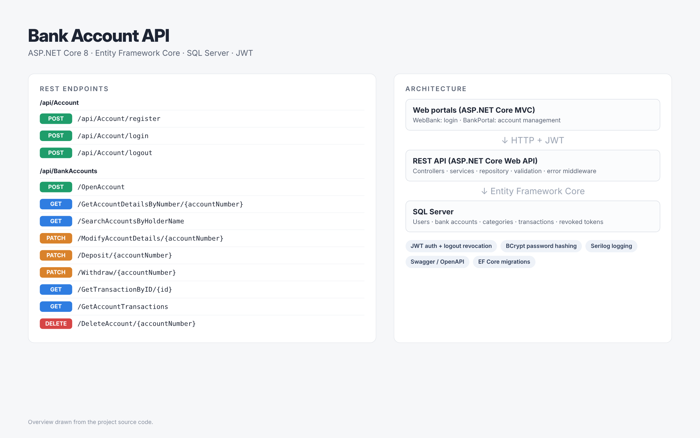

# Bank Account API

A banking back end built during my internship at Diyar United Company (Oct 2024 – Feb 2025).
It covers user sign-up and login, opening and managing bank accounts, deposits, withdrawals and transaction history,
with two web portals that use the API.

## Tech stack

- **C# / ASP.NET Core 8 Web API** for the REST API
- **Entity Framework Core + SQL Server** for data access, with code-first migrations
- **JWT authentication** with logout token revocation
- **BCrypt** password hashing
- **Serilog** structured logging
- **Swagger / OpenAPI** documentation
- **ASP.NET Core MVC** web portals (WebBank and BankPortal)

## Features

- Register, log in and log out users with JWT tokens
- Open, view, search, update and delete bank accounts
- Deposit and withdraw money, with balance checks
- View a single transaction or an account's transaction history
- Input validation (for example account category and holder age)
- Central error handling through custom middleware

## API endpoints

| Method | Endpoint |
|---|---|
| POST | `/api/Account/register` |
| POST | `/api/Account/login` |
| POST | `/api/Account/logout` |
| POST | `/api/BankAccounts/OpenAccount` |
| GET | `/api/BankAccounts/GetAccountDetailsByNumber/{accountNumber}` |
| GET | `/api/BankAccounts/SearchAccountsByHolderName` |
| PATCH | `/api/BankAccounts/ModifyAccountDetails/{accountNumber}` |
| PATCH | `/api/BankAccounts/Deposit/{accountNumber}` |
| PATCH | `/api/BankAccounts/Withdraw/{accountNumber}` |
| GET | `/api/BankAccounts/GetTransactionByID/{id}` |
| GET | `/api/BankAccounts/GetAccountTransactions` |
| DELETE | `/api/BankAccounts/DeleteAccount/{accountNumber}` |

## Project structure
